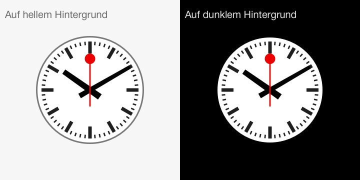

# SBB Uhr

The Swiss railway clock (SBB Bahnhofsuhr) for the screen: a JavaScript library that draws it in any web page, a full-screen web page you can install as an app or pop out into Picture-in-Picture, and a tiny always-on-top desktop clock for macOS and Windows.



The clock moves like the real one: the red second hand sweeps round in 58.5 seconds, waits about 1.5 seconds at 12, and only then do the minute and hour hands jump forward, with a small bounce.

## Contents

- [Project structure](#project-structure)
- [Web page](#web-page)
- [JavaScript library](#javascript-library)
- [Desktop mini clock](#desktop-mini-clock)
  - [macOS](#macos)
  - [Windows](#windows)
- [Icons](#icons)
- [How the hands move](#how-the-hands-move)
- [License](#license)

## Project structure

```
sbb-clock/
├── index.html                  Full-screen clock page (Picture-in-Picture, installable as an app)
├── sbbUhr-1.3.js               The clock library
├── manifest.webmanifest        Web app manifest: name, colours and icons for "Install as app"
├── sbb-clock.svg               The clock as one static SVG (favicon and icon source)
├── SBB-Uhr.jpg                 Preview picture (used in this README)
├── files/                      App icons: PNGs for the web app and iOS home screen
├── generate-apple-icons.html   Tool page that renders the iOS home-screen icons
├── icon_maker                  Earlier copy of the clock SVG (has no file extension)
├── zz.svg                      Empty file, not used
└── desktop/                    Always-on-top mini clock
    ├── mac/
    │   ├── SBB Mini Clock (Mac).command        Double-click to start (or restart) the clock
    │   ├── Quit SBB Mini Clock (Mac).command   Double-click to close it
    │   ├── build-mac-app.sh                    Builds "SBB Mini Clock.app"
    │   └── sbb-mini-mac.js                     The clock (JavaScript for Automation)
    └── windows/
        ├── SBB Mini Clock (Windows).cmd        Double-click to start the clock
        └── sbb-mini-windows.ps1                The clock (PowerShell + WPF)
```

## Web page

`index.html` shows the clock in the middle of a black page and scales it with the window (70 % of its shorter side).

**Run it.** Open `index.html` in a browser. Installing it as an app only works when the page comes from a web server, so for that serve the folder, for example:

```bash
cd sbb-clock
python3 -m http.server 8000
# then open http://localhost:8000
```

**Picture-in-Picture.** Click the button at the bottom right, or press `P`, to get a small clock window that stays on top of other windows. Press `P` again to close it.

- The clock is drawn onto a canvas and shown as a video in Picture-in-Picture, which gives a window without a title bar (Chrome, Edge, Safari).
- Browsers that support only Document Picture-in-Picture get that instead: the real clock in a floating window, with a title bar.
- In browsers that support neither (Firefox), the button is hidden.
- The Picture-in-Picture clock keeps running at full speed while the tab is in the background.

**Install as an app.** The page has a web app manifest, so Chrome and Edge can install it:

- Chrome: ⋮ → Cast, save and share → Install page as app
- Edge: ⋯ → Apps → Install this site as an app
- iPhone/iPad (Safari): Share → Add to Home Screen. It starts full screen, with the icons from `files/`.

The installed clock opens in its own window, which can be made much smaller than a Picture-in-Picture window. The clock fills it, and the Picture-in-Picture button is hidden. On Windows, PowerToys *Always On Top* (Win + Ctrl + T) keeps it above other windows.

## JavaScript library

`sbbUhr-1.3.js` has no dependencies. It draws the face and the three hands as SVG images on top of each other and turns the hands with CSS.

### Quick start

```html
<script src="sbbUhr-1.3.js"></script>

<div id="clock" style="width: 300px; height: 300px"></div>

<script>
	var myClock = new sbbUhr("clock", true, 60);
	myClock.start();
</script>
```

### Constructor

```js
new sbbUhr(container, background, fps)
```

| Parameter | Type | Default | Description |
|---|---|---|---|
| `container` | string or element | (required) | The `id` of the element that hosts the clock, or the element itself. An element can also be in another window, for example a Document Picture-in-Picture window. |
| `background` | boolean | `false` | `true`: face for a dark background (no grey outer ring). `false`: face for a light background. |
| `fps` | number | every frame | Refresh rate in frames per second. Use more than 10 for a smooth second hand. If left out, the clock is redrawn on every animation frame. |

If you pass a number as the second argument, it is taken as `fps` and the light face is used.

The clock fills its container and stays round: it takes the container's shorter side and is centred in it. Give the container a size, for example in `px`, `%` or `vmin`. The clock follows any later change of size by itself.

### Methods

| Method | Description |
|---|---|
| `myClock.start()` | Starts the clock (calling it again restarts it). |
| `myClock.stop()` | Stops the clock; the hands stay where they are. |
| `myClock.angles(date)` | Returns the hand angles for a `Date` as `{ s, m, h }` in degrees, 0 being 12 o'clock. Useful to draw the clock yourself, as `index.html` does for Picture-in-Picture. |

The SVG sources of the face and hands are available as `myClock.svg.face`, `myClock.svg.faceDark`, `myClock.svg.hours`, `myClock.svg.minutes` and `myClock.svg.seconds`.

## Desktop mini clock

A small, borderless clock that floats above all other windows (on a Mac also on every desktop and next to full-screen apps). It can be much smaller than any browser window, from 48 px. It needs nothing to be installed: the Mac version uses tools built into macOS, the Windows version uses PowerShell, which is built into Windows.

| | macOS | Windows |
|---|---|---|
| Move | Drag with the left mouse button | Drag with the left mouse button |
| Resize | Right-click → 48 to 256 px | Right-click → Size, or the mouse wheel (32 to 600 px) |
| Quit | Right-click → Quit, or `Quit SBB Mini Clock (Mac).command` | Right-click → Quit |
| Default place | Top-right corner, 96 px | Top-right corner, 96 px |

Position and size are saved when you move or resize the clock (Mac) or when you quit it (Windows), and restored at the next start.

### macOS

All files are in `desktop/mac/`.

**Start:** double-click `SBB Mini Clock (Mac).command`. The Terminal window that opens closes by itself after a second, and the clock keeps running. If the clock is already running, it restarts instead of opening a second one.

**Quit:** right-click the clock → **Quit**, or double-click `Quit SBB Mini Clock (Mac).command`.

The first time you open each `.command` file, macOS may refuse to open it because it comes from an unidentified developer. Right-click the file → **Open** → **Open**. After that, a double-click works.

**As a real app.** Build `SBB Mini Clock.app` once:

```bash
./desktop/mac/build-mac-app.sh
```

The app appears in `desktop/mac/`, with the SBB clock on a black square as its icon. Move it to Applications to start it from Launchpad or Spotlight. To start it with your Mac, add it in System Settings → General → Login Items. The app contains its own copy of `sbb-mini-mac.js`, so run the build script again after changing that file. The built app is not stored in git (see `.gitignore`).

**From Terminal**, mostly useful while changing the code, because errors are printed:

```bash
osascript -l JavaScript desktop/mac/sbb-mini-mac.js     # Ctrl-C stops it
```

**Change the default size or position.** In `sbb-mini-mac.js`, `size` sets the default size and the `NSMakeRect(...)` line sets the default position. The sizes in the right-click menu are in `SIZES`. The saved position and size take priority over these defaults. To go back to the defaults, delete the saved values and restart the clock:

```bash
defaults delete com.apple.osascript "NSWindow Frame SBBMiniClock"
```

**How it works.** `sbb-mini-mac.js` is JavaScript for Automation (JXA), run by the `osascript` command that comes with macOS. Through JXA it uses the macOS frameworks directly:
- a borderless, transparent window at floating level, on all Spaces and next to full-screen apps;
- a WebKit view that draws the clock face (SVG) and turns the hands with JavaScript;
- a transparent view on top that handles dragging and the right-click menu.

It has no Dock icon and no menu bar. The `.command` launchers detach the clock from Terminal, so Terminal can close its window without asking.

### Windows

All files are in `desktop/windows/`.

**Start:** double-click `SBB Mini Clock (Windows).cmd`. No console window stays open.

**Quit:** right-click the clock → **Quit**.

**Start with Windows (optional):** press Win + R, type `shell:startup`, and put a shortcut to `SBB Mini Clock (Windows).cmd` in the folder that opens.

**Change the default size or position.** In `sbb-mini-windows.ps1`, `Width` and `Height` in the XAML set the default size, and the lines after `# Default: top-right corner` set the position. The menu sizes are the `MenuItem` entries in the XAML. Saved values are in `%APPDATA%\SBBMiniClock\settings.json`; delete that file to go back to the defaults. Saved values are also ignored if the clock would no longer fit on the screen, for example after unplugging a monitor.

**How it works.** `sbb-mini-windows.ps1` builds a borderless, transparent, always-on-top WPF window from XAML. The clock face is drawn as vector paths, the same drawing as `sbb-clock.svg`, and a timer turns the hands about 30 times a second.

**Restricted PCs.** The script needs PowerShell in full language mode. On PCs where a company policy restricts PowerShell (Constrained Language Mode or AppLocker), it won't start.

## Icons

| File | Used for |
|---|---|
| `sbb-clock.svg` | Favicon, and the "any size" icon in the web app manifest |
| `files/icon-192x192.png`, `files/icon-512x512.png` | Web app icons (manifest). The 512 px icon is also the source of the macOS app icon. |
| `files/apple-touch-icon*.png` | iPhone/iPad home-screen icons, at 180, 152, 167 and 120 px |

To make new iOS icons, open `generate-apple-icons.html` in a browser. It renders the clock SVG (or one you drop in) on a square with your choice of padding and background colour, and downloads every size with the file names `index.html` expects. Everything runs in the page; nothing is uploaded.

## How the hands move

The library and both desktop clocks use the same movement:

- **Seconds:** `angle = seconds × 360 / 58.5 + milliseconds × 0.006`, capped at 360°. The hand goes round in 58.5 seconds and then waits at 12 until the minute is over.
- **Minutes:** at the start of every minute the hand jumps 6° forward, with an elastic easing over 2 seconds (`easeOutElastic`).
- **Hours:** moves 0.5° each minute with the same easing, so it also steps once a minute.

The real clock works the same way: its second hand pauses at 12 to wait for the central "minute impulse" that moves all the station clocks at once.

## License

Apache License 2.0; see [LICENSE](LICENSE).

The library header reads "Digital SBB Uhr V 1.3 (marke@sbb.ch), all rights reserved by SBB AG, Switzerland". The SBB clock design is a trademark of SBB AG (Swiss Federal Railways).
